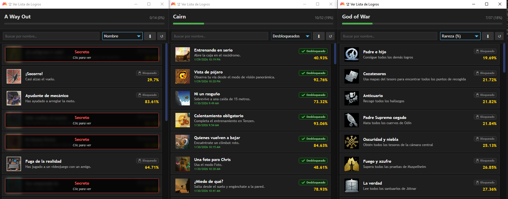
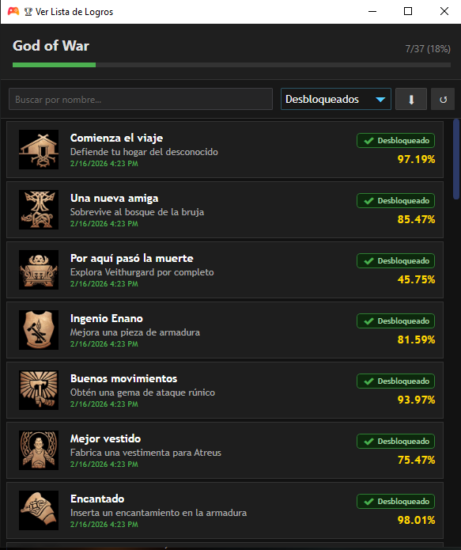
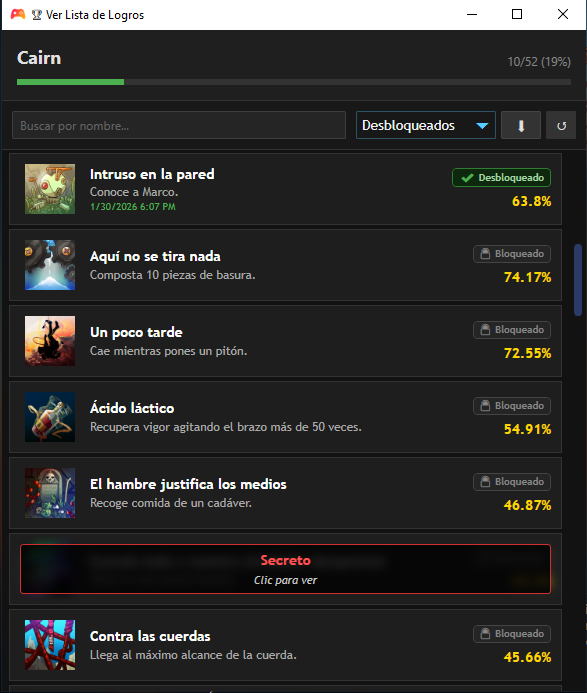
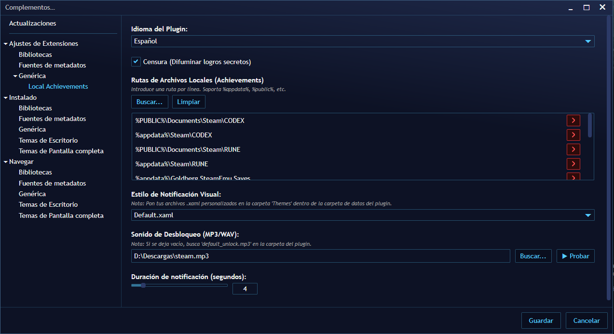

# Playnite Local Achievements Plugin

<p align="center">
  
</p>

<p align="center">
  <a href="https://github.com/JosefNemec/Playnite">
    
  </a>
  
  
  
</p>

> [!IMPORTANT]
> This project was built mostly with AI-assisted vibe-coding, with manual fixes while learning C#. It is a fun learning project and the code can be messy in some areas.

## What It Does

- Reads local achievements from `.ini`/text files used by Steam emulator-style setups.
- Shows achievements inside Playnite.
- Displays unlock notifications with custom sound/themes.
- Includes language selection: English and Spanish.
- Current readers are tested mainly with CODEX/RUNE-style files.
- Designed to add more readers over time.

### Scope

- Intended for Steam-version game layouts that use `steam_api64.dll`.

## Screenshots

| Achievements List | Achievements List 2 | Settings |
|---|---|---|
|  |  |  |

## Installation (Recommended): From Release `.pext`

> [!TIP]
> This is the easiest method for users with zero coding knowledge.

1. Go to **Releases** in this repository.
2. Download the latest `Local-Achievements-<version>.pext`.
3. Open Playnite and drag/drop the `.pext` into Playnite.
4. Restart Playnite if requested.
5. Open `Settings -> Add-ons -> Generic -> Local Achievements`.
6. Configure your local achievement paths and save.

## Manual Installation (Alternative)

If you install manually, copy plugin output files into `%APPDATA%\Playnite\Extensions\<PluginId>`.

## For Developers

```powershell
dotnet restore
dotnet build -c Release
powershell -ExecutionPolicy Bypass -File scripts/PackPext.ps1 -Configuration Release
```

Generated package:
- `dist/Local-Achievements-1.0.1.pext` (friendly name)

## Transparency

- AI-assisted project (vibe-coding heavy).
- I am not a professional C# developer.
- GitHub beginner; improving over time.
- Forks and improvements are welcome.

## License

GNU GPL v3.0 (`LICENSE`).

## Contributing

Please read `CONTRIBUTING.md`.

## Security

Please read `SECURITY.md`.
